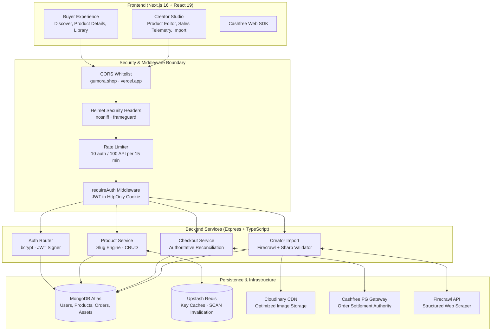

# Gumora SaaS Platform
### Full-Stack Digital Products Marketplace with Cashfree Payments, Redis Caching, and Firecrawl Content Ingestion

[](https://www.typescriptlang.org/)
[](https://nextjs.org/)
[](https://react.dev/)
[](https://expressjs.com/)
[](https://www.mongodb.com/)
[](https://upstash.com/)
[](https://www.cashfree.com/)
[](https://cloudinary.com/)
[](backend/tests/)

> **A full-stack creator commerce marketplace built to demonstrate decoupled cross-origin session authentication, server-authoritative payment reconciliation, structured AI content extraction, and multi-tier caching.**

---

## Overview

Gumora is a digital products commerce platform inspired by Gumroad. It provides independent creators with tools to list digital downloads, automate content ingestion from external URLs, and monitor real-time sales telemetry, while providing buyers with a friction-free discovery catalog, Cashfree payment checkout, and an authenticated digital asset library.

The platform is designed around a decoupled dual-host architecture: a Next.js 16 App Router frontend paired with an Express/TypeScript REST backend. The system enforces zero-trust payment verification (never relying on client-side status flags), cross-origin HTTP-only cookie sessions, cursor-based Redis cache invalidation, and automated media inspection via Sharp before CDN upload.

### Core Engineering Highlights

1. **Server-Authoritative Payment Settlement**: The payment verification boundary ([`backend/src/routes/checkout.ts`](backend/src/routes/checkout.ts)) strictly isolates payment confirmation from client input. Orders transition from `pending` to `paid` only after the backend polls Cashfree's authoritative REST gateway (`/orders/${providerOrderId}`) and validates `order_status === "PAID"`.
2. **Cross-Origin Session Security**: Configured for independent cross-domain deployment (Vercel frontend $\longleftrightarrow$ Render backend) using signed JWT cookies with `SameSite=None; Secure; HttpOnly`, fortified with Helmet security headers, CORS origin whitelisting, and tiered rate limiting.
3. **Multi-Tier Redis Caching**: Integrates Upstash Redis ([`backend/src/lib/cache.ts`](backend/src/lib/cache.ts)) with structured key namespaces for product listings (60s TTL), slug-based lookups (300s TTL), and user libraries (60s TTL). Utilizes non-blocking cursor-based `SCAN` pattern purging to ensure cache consistency without blocking the event loop.
4. **Firecrawl Ingestion & Media Pipeline**: Creators can import products by URL ([`backend/src/routes/creatorImport.ts`](backend/src/routes/creatorImport.ts)). Firecrawl extracts product descriptions constrained to strict JSON schemas, while candidate assets undergo Sharp-based dimension and MIME validation before Cloudinary CDN ingestion.
5. **Full-Spectrum Testing & CI/CD**: Backed by a multi-stage GitHub Actions pipeline executing TypeScript compilation (`tsc --noEmit`), Vitest unit/middleware tests, and Playwright Chromium end-to-end tests. The E2E job runs on `main` branch pushes only, targeting a Vercel preview deployment.

---

## Deployment Status

> [!NOTE]
> **Current Deployment State (October 2026):**
> * **Frontend Client**: Deployed on Vercel at [**https://www.gumora.shop**](https://www.gumora.shop) (accessible).
> * **Backend API Service**: Configured on Render at `https://api.gumora.shop` (custom domain). The backend is hosted on Render's free tier and enters an automated suspended state after periods of inactivity. At the time of documentation, the backend endpoint returns HTTP 503 (`x-render-routing: suspend`) and is not actively serving requests.
> * **Local Evaluation**: For a fully functional evaluation with backend and database, follow the [Local Development Setup](#local-development-setup) instructions below.

---

## Application Walkthrough & User Journeys

| Creator Dashboard | Product Editor & Ingestion | Checkout Flow |
|---|---|---|
|  |  |  |
| *Real-time sales revenue, volume metrics, and product inventory management.* | *Asset management, pricing controls, and AI-assisted content import.* | *Seamless buyer checkout powered by Cashfree Payment Gateway.* |

| Buyer Library | Discovery Catalog | Authentication |
|---|---|---|
|  |  |  |
| *Authenticated download access for purchased digital downloads.* | *Public marketplace catalog with Redis-cached product cards.* | *Session authentication with cross-origin HTTP-only cookies.* |

---

## System Architecture




---

## Technical Implementation Details

### 1. Server-Authoritative Payment Lifecycle ([`backend/src/routes/checkout.ts`](backend/src/routes/checkout.ts))

Payment fraud frequently arises from client-side state manipulation (e.g. spoofing a success redirect callback). Gumora eliminates this attack vector through direct gateway reconciliation:

```
[Buyer Client]          [Gumora Backend]             [Cashfree Gateway]           [MongoDB]
      │                        │                             │                        │
      ├── POST /create-session ┼────────────────────────────►│                        │
      │   (productId)          │ Create Order (Pending)      │                        ├─► Order (pending)
      │                        │────────────────────────────►│ POST /orders           │
      │                        │◄────────────────────────────┤ (payment_session_id)   │
      │◄── payment_session_id ─┤                             │                        │
      │                        │                             │                        │
      ├── Completes Payment ───┼────────────────────────────►│                        │
      │                        │                             │                        │
      ├── POST /confirm ──────►│                             │                        │
      │   (orderId)            │ GET /orders/{providerOrderId}│                        │
      │                        │────────────────────────────►│                        │
      │                        │◄────────────────────────────┤ order_status: "PAID"   │
      │                        │                             │                        │
      │                        │ Sequential DB Writes ───────┼───────────────────────►├─► Order (paid)
      │                        │ (status="paid", paidAt=now) │                        ├─► Product (soldCount +1)
      │◄── 200 OK (Purchased) ─┤                             │                        │
```

1. **Session Creation**: The client requests a checkout session for a valid `productId`. The backend persists an order with `status: "pending"` and dispatches an authenticated request to Cashfree (`/orders`), receiving a `payment_session_id`.
2. **Authoritative Verification**: When the buyer returns to the application, `/api/checkout/confirm` queries Cashfree directly. Only if `resp.data.order_status === "PAID"` does the system update the order record and subsequently increment the creator's product sales counter (`stats.soldCount`) in a second database write.
3. **Public Re-Check**: For unauthenticated redirect scenarios, `/api/checkout/confirm-public` validates the provider status without exposing user profile details.

### 2. Cross-Origin Session Security ([`backend/src/middleware/requireAuth.ts`](backend/src/middleware/requireAuth.ts))

Because the frontend is deployed on Vercel (`gumora.shop`) and the API resides on Render (`api.gumora.shop`), standard cross-origin cookie restrictions apply:

* **Cookie Constraints**:
  ```typescript
  res.cookie(process.env.COOKIE_NAME, token, {
    httpOnly: true,
    secure: true,
    sameSite: "none",
    maxAge: 7 * 24 * 60 * 60 * 1000, // 7 days
  });
  ```
* **Ownership Boundary Enforcement**:
  Every creator-facing mutation invokes `loadOwnProduct` or `ownProductOrSend`, checking that `String(product.creatorId) === req.user.id`. Requests attempting to alter another creator's product fail closed with `HTTP 403 Forbidden`.
* **Security Headers & Rate Limiting**:
  - Helmet configured with `nosniff` and cross-origin resource policy.
  - Dedicated authentication rate limiter: 10 attempts per 15-minute window (`/api/auth/login`, `/api/auth/register`).
  - General API rate limiter: 100 requests per 15-minute window across all other endpoints.

### 3. Upstash Redis Caching Engine ([`backend/src/lib/cache.ts`](backend/src/lib/cache.ts))

To prevent database bottlenecking on high-read public discovery routes, Gumora integrates an Upstash Redis caching layer:

* **Namespaced Key Architecture**:
  - `products:list` — Public marketplace product catalog (TTL: 60s).
  - `products:slug:${slug}` — Individual product detail page (TTL: 300s).
  - `library:user:${userId}` — Authenticated buyer asset library (TTL: 60s).
* **Cursor-Based Invalidation**:
  Because the serverless Redis tier restricts the blocking `KEYS` command, cache purging implements a non-blocking `SCAN` iteration:
  ```typescript
  export async function cacheDeletePattern(pattern: string): Promise<boolean> {
    const client = getRedis();
    if (!client) return false;
    let cursor = 0;
    do {
      const result = await client.scan(cursor, { match: pattern, count: 100 });
      cursor = Number(result[0]);
      const keys = result[1] as string[];
      if (keys.length > 0) {
        await Promise.all(keys.map((key) => client.del(key)));
      }
    } while (cursor !== 0);
    return true;
  }
  ```
* **Event-Driven Cache Busting**: Product creation, edits, and deletions automatically invalidate `products:list` and the specific product slug key.

### 4. AI Content Ingestion Pipeline ([`backend/src/routes/creatorImport.ts`](backend/src/routes/creatorImport.ts))

Gumora enables creators to import products from external storefronts:

1. **Firecrawl Scraping**: Dispatches external URLs to Firecrawl with schema constraints (`PRODUCT_DESC_SCHEMA`), extracting structured summaries and candidate image URLs.
2. **Asset Validation (`downloadAndInspectImage`)**: Candidate image buffers are downloaded, verified for valid MIME types (PNG, JPEG, WebP), and inspected for dimension bounds using Sharp.
3. **CDN Upload**: Validated image buffers are piped directly to Cloudinary under isolated product folder paths (`gumroad-ai-clone/products/{productId}`) and persisted as `ImageAsset` documents.

---

## API Reference

All routes are mounted under `/api` and enforce strict JSON payload validation:

| Method | Endpoint | Description | Auth Required |
| :--- | :--- | :--- | :--- |
| `GET` | `/healthz` | System health check and uptime probe | Public |
| `POST` | `/api/auth/register` | Register new user account | Public |
| `POST` | `/api/auth/login` | Authenticate user and issue HTTP-only cookie | Public |
| `GET` | `/api/auth/me` | Fetch authenticated user profile | Authenticated |
| `POST` | `/api/auth/logout` | Clear session cookie | Authenticated |
| `GET` | `/api/products` | Browse public product catalog (Redis cached) | Public |
| `GET` | `/api/products/:slug` | Retrieve single product by URL slug | Public |
| `GET` | `/api/creator/products` | List authenticated creator's products | Creator |
| `POST` | `/api/creator/products` | Create a new draft product | Creator |
| `PUT` | `/api/creator/products/:productId` | Update product metadata and pricing | Creator (Owner) |
| `DELETE` | `/api/creator/products/:productId`| Delete product and purge cache | Creator (Owner) |
| `POST` | `/api/creator/products/:productId/firecrawl/scrape` | Extract product metadata via Firecrawl | Creator (Owner) |
| `POST` | `/api/creator/products/:productId/assets/ingest` | Inspect and upload validated assets | Creator (Owner) |
| `GET` | `/api/creator/sales` | Aggregated sales telemetry and buyer list | Creator |
| `POST` | `/api/checkout/create-session` | Initialize Cashfree payment session | Authenticated |
| `POST` | `/api/checkout/confirm` | Authoritative server-side payment verification | Authenticated |
| `POST` | `/api/checkout/confirm-public` | Public order status reconciliation | Public |
| `GET` | `/api/library` | List buyer's purchased digital assets | Authenticated |
| `GET` | `/api/library/:orderId/download` | Generate secure download redirect | Authenticated (Buyer) |

---

## Testing & Quality Assurance

The codebase includes automated unit, integration, and end-to-end test suites:

### 1. Backend Unit & Middleware Tests (Vitest)
Located in [`backend/tests/api.test.ts`](backend/tests/api.test.ts) and [`backend/tests/utils.test.ts`](backend/tests/utils.test.ts):
* **Health & Route Introspection**: Verifies `/healthz` and root API info endpoints.
* **Authentication Middleware**: Verifies `HTTP 401 Unauthorized` fail-closed behavior across `/api/library`, `/api/auth/me`, and `/api/creator/*` when unauthenticated.
* **Request Validation**: Verifies Zod schema rejections on missing email, password, or invalid checkout parameters.
* **Security Headers**: Asserts Helmet security headers (`X-Content-Type-Options: nosniff`).
* **CORS Validation**: Asserts allowed origins receive credentials and headers while unauthorized origins are rejected.
* **Slug Utilities**: Validates collision avoidance, unicode trimming, and incremental counter allocation (`slug`, `slug-2`).

### 2. Frontend End-to-End Tests (Playwright)
Located in [`client/e2e/basic.spec.ts`](client/e2e/basic.spec.ts):
* **Homepage & Navigation**: Asserts brand title and responsive navigation links.
* **Authentication Flows**: Validates form visibility and client-side validation states on `/login` and `/register`.
* **Route Protection**: Validates that unauthenticated requests to `/discover` redirect to `/login`.
* **Backend Health Probe**: End-to-end network check ensuring the frontend can communicate with the backend.

### 3. Automated CI/CD Pipeline ([`.github/workflows/ci.yml`](.github/workflows/ci.yml))
The workflow triggers on pull requests and pushes to `main`. It runs backend and frontend jobs in parallel, followed conditionally by end-to-end verification:
1. `backend` (parallel): Node 20 setup $\rightarrow$ `npm ci` $\rightarrow$ `npm run typecheck` $\rightarrow$ `npm test` (Vitest) $\rightarrow$ `npm run build`.
2. `frontend` (parallel): Node 20 setup $\rightarrow$ `npm ci` $\rightarrow$ `npm run typecheck` $\rightarrow$ `npm run lint` $\rightarrow$ `npm run build`.
3. `e2e` (dependent & conditional): Depends on both `backend` and `frontend` completing successfully (`needs: [backend, frontend]`), and is gated to `refs/heads/main` pushes only (`if: github.ref == 'refs/heads/main'`). It installs Playwright Chromium browsers and runs end-to-end verification against the Vercel preview deployment (`gamora-saas-platform.vercel.app`). Note: because the CI workflow points `NEXT_PUBLIC_API_URL` to `gumora-platform-backend.onrender.com`, if that Render instance is suspended, the backend health probe test will be skipped by the current spec.

---

## Local Development Setup

### Prerequisites
* **Node.js**: v20.x or v22.x LTS
* **MongoDB**: Local MongoDB instance or MongoDB Atlas connection URI
* **Cloudinary Account**: Free tier credentials for image uploads
* **Cashfree Account**: Sandbox credentials for testing payments
* **Firecrawl API Key** *(Optional)*: For AI scraping functionality
* **Upstash Redis** *(Optional)*: For caching layer (falls back to direct MongoDB queries if omitted)

### 1. Clone the Repository
```bash
git clone https://github.com/AkshayAlgoX/gumora-saas-platform.git
cd gumora-saas-platform
```

### 2. Backend Setup
```bash
cd backend
npm install

# Configure environment variables
cp .env.example .env
```

Configure the following variables in `backend/.env`:

| Variable Name | Required | Purpose | Example |
| :--- | :--- | :--- | :--- |
| `PORT` | Yes | Backend port | `5000` |
| `MONGODB_URI` | Yes | MongoDB connection string | `mongodb://localhost:27017/gumora` |
| `JWT_SECRET` | Yes | JWT signing secret | Random 32+ character string |
| `COOKIE_NAME` | Yes | Session cookie identifier | `gumora_session` |
| `CASHFREE_APP_ID` | Yes | Cashfree client application ID | Sandbox / Production App ID |
| `CASHFREE_SECRET_KEY` | Yes | Cashfree secret key | Sandbox / Production Secret |
| `CASHFREE_ENV` | Yes | Cashfree environment mode | `sandbox` or `production` |
| `CLOUDINARY_CLOUD_NAME` | Yes | Cloudinary cloud identifier | Cloud name |
| `CLOUDINARY_API_KEY` | Yes | Cloudinary API key | API key |
| `CLOUDINARY_API_SECRET` | Yes | Cloudinary secret | Secret string |
| `WEB_BASE_URL` | Yes | Frontend client URL | `http://localhost:3000` |
| `FRONTEND_ORIGIN` | Yes | CORS allowed origin | `http://localhost:3000` |
| `UPSTASH_REDIS_REST_URL` | No | Upstash Redis REST URL | Optional |
| `UPSTASH_REDIS_REST_TOKEN` | No | Upstash Redis REST token | Optional |
| `FIRECRAWL_API_KEY` | No | Firecrawl API key | Optional |

Start the backend development server:
```bash
npm run dev
```

### 3. Frontend Setup
In a new terminal window:
```bash
cd client
npm install

# Configure environment variables
cp .env.example .env.local
```

Configure `client/.env.local`:
```env
NEXT_PUBLIC_API_URL=http://localhost:5000
NEXT_PUBLIC_CASHFREE_ENV=sandbox
```

Start the Next.js development server:
```bash
npm run dev
```

Open [**http://localhost:3000**](http://localhost:3000) to view the application.

---

## Repository Structure

```text
gumora-saas-platform/
├── .github/
│   └── workflows/
│       └── ci.yml              # GitHub Actions CI/CD pipeline
├── backend/
│   ├── src/
│   │   ├── app.ts              # Express application factory & middleware
│   │   ├── server.ts           # Server initialization & database bootstrap
│   │   ├── db.ts               # Mongoose MongoDB connection
│   │   ├── lib/
│   │   │   ├── auth.ts         # bcrypt password hashing & JWT helpers
│   │   │   ├── cache.ts        # Upstash Redis caching & SCAN invalidation
│   │   │   ├── cashfree.ts     # Cashfree PG axios client
│   │   │   ├── cloudinary.ts   # Cloudinary buffer upload integration
│   │   │   ├── downloadImage.ts# Image buffer fetching & Sharp inspection
│   │   │   ├── firecrawl.ts    # Firecrawl web scraping integration
│   │   │   └── sentry.ts       # Sentry error monitoring configuration
│   │   ├── middleware/
│   │   │   └── requireAuth.ts  # Cookie JWT verification & user injection
│   │   ├── models/             # Mongoose schemas (User, Product, Order, ImageAsset)
│   │   ├── routes/             # REST endpoints (auth, checkout, creator, library, public)
│   │   └── utils/              # Slug generation & uniqueness collision resolver
│   ├── tests/                  # Vitest unit & middleware tests
│   ├── tsconfig.json
│   └── package.json
├── client/
│   ├── src/
│   │   ├── app/                # Next.js 16 App Router pages
│   │   │   ├── (auth)/         # Login & registration flows
│   │   │   ├── (buyer)/        # Discovery catalog, library, checkout
│   │   │   ├── (creator)/      # Creator dashboard, product editor, sales
│   │   │   └── api/            # Client-side API proxy routes
│   │   └── lib/                # API client & TypeScript interfaces
│   ├── components/             # Reusable React components (Radix UI + Tailwind)
│   ├── e2e/                    # Playwright end-to-end tests
│   ├── playwright.config.ts
│   └── package.json
├── screens/                    # Authentic application walkthrough screenshots
└── README.md
```

---

## Authorship & Project Attribution

* **Author:** Akshaya R ([@AkshayAlgoX](https://github.com/AkshayAlgoX))
* **License:** MIT License. See [LICENSE](LICENSE) for details.
