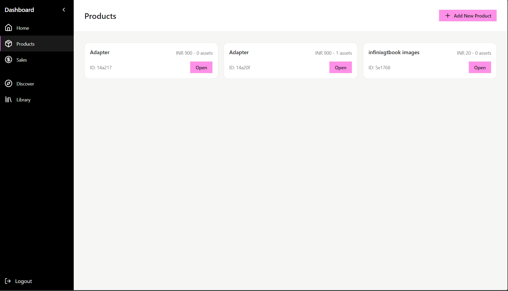
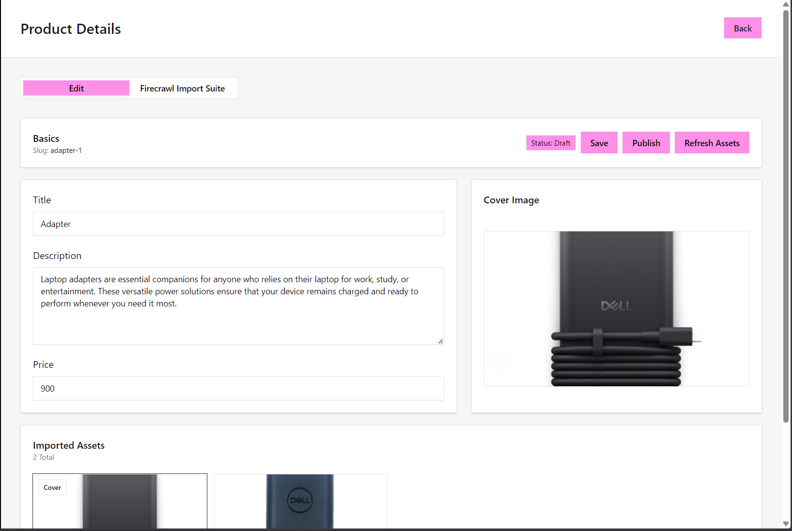
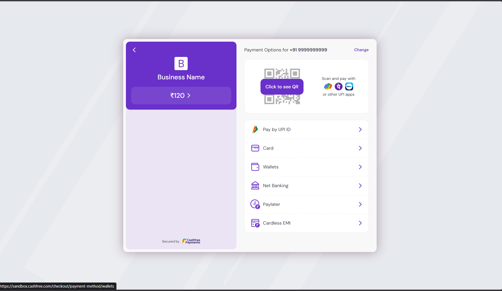
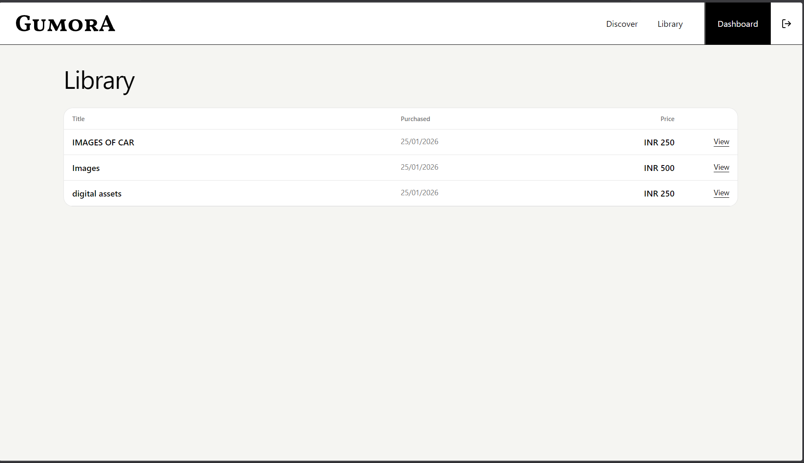
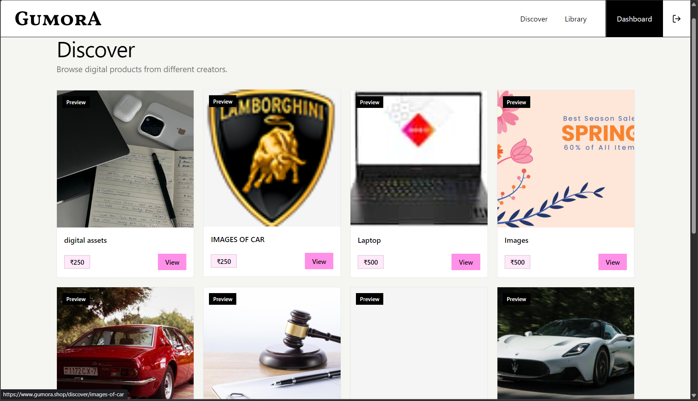
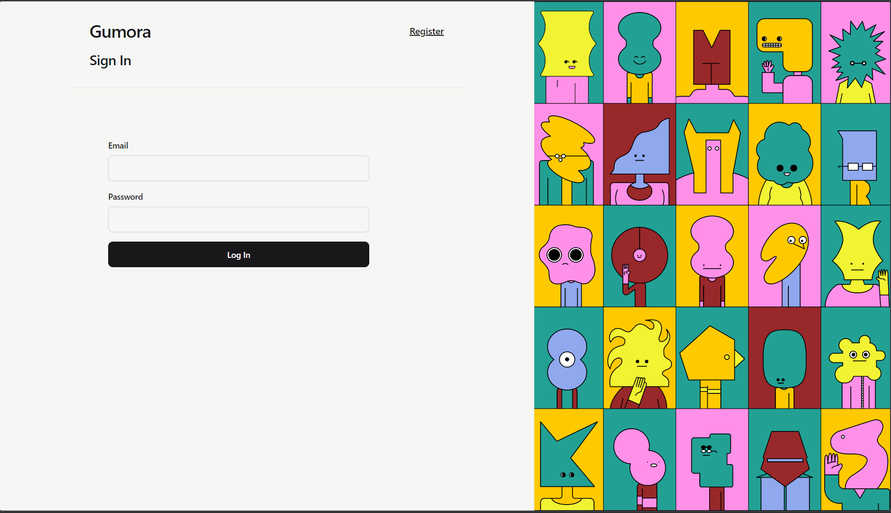
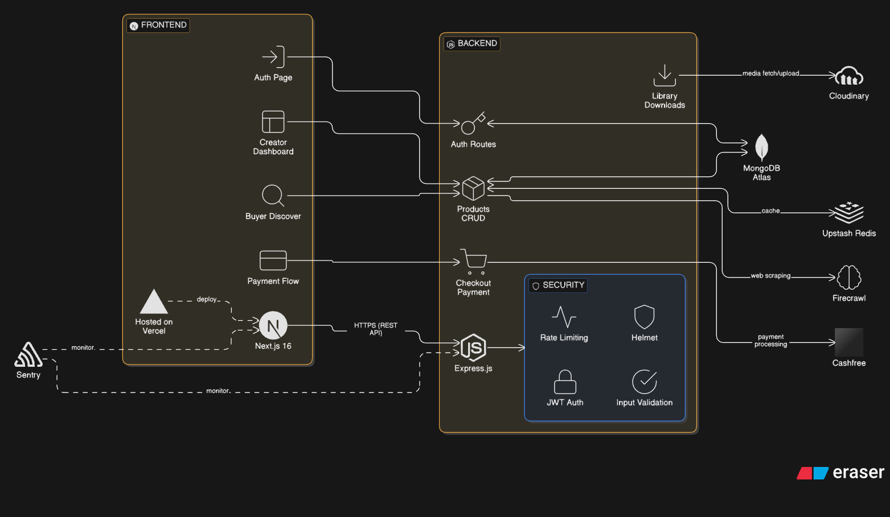
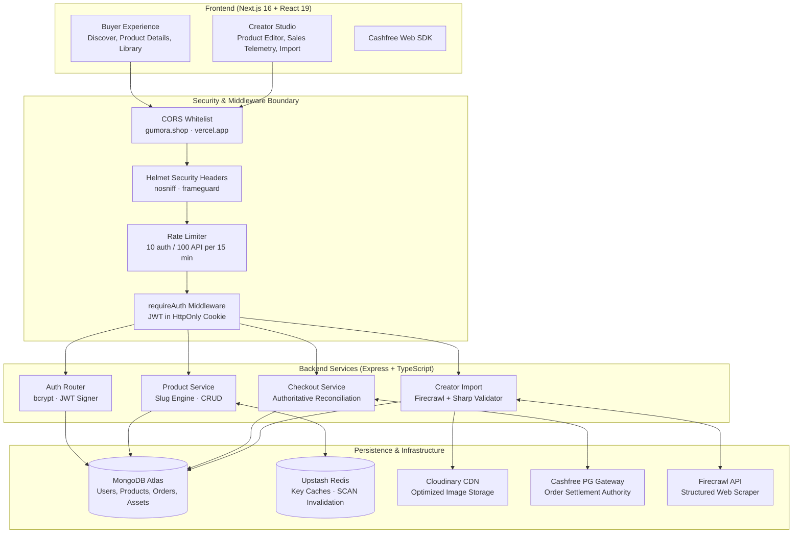

# Gumora SaaS Platform
### Full-Stack Digital Products Marketplace with Cashfree Payments, Redis Caching, and Firecrawl Content Ingestion

[](https://www.typescriptlang.org/)
[](https://nextjs.org/)
[](https://react.dev/)
[](https://expressjs.com/)
[](https://www.mongodb.com/)
[](https://upstash.com/)
[](https://www.cashfree.com/)
[](https://cloudinary.com/)

> **A full-stack creator commerce marketplace built to demonstrate decoupled cross-origin session authentication, server-authoritative payment reconciliation, structured AI content extraction, and multi-tier caching.**

---

## Overview

Gumora is a digital products commerce platform inspired by Gumroad. It provides independent creators with tools to list digital downloads, automate content ingestion from external URLs, and monitor real-time sales telemetry, while providing buyers with a friction-free discovery catalog, Cashfree payment checkout, and an authenticated digital asset library.

The platform is designed around a decoupled dual-host architecture: a Next.js 16 App Router frontend paired with an Express/TypeScript REST backend. The system verifies every payment with Cashfree on the server (never relying on client-side status flags), uses cross-origin HTTP-only cookie sessions (see the session caveat under [Known Limitations](#known-limitations)), cursor-based Redis cache invalidation, and automated media inspection via Sharp before CDN upload.

### Core Engineering Highlights

1. **Transactional Payment Settlement**: [`backend/src/services/settlement.ts`](backend/src/services/settlement.ts) fetches the order from Cashfree, requires `order_id`, `order_status === "PAID"`, `INR` and an exact paise-level amount match, and then moves the order `pending → paid` and increments `stats.soldCount` in one MongoDB transaction. Retries, duplicate callbacks and concurrent confirmations settle once. Design, outcome codes and limitations: [`docs/payment-settlement.md`](docs/payment-settlement.md).
2. **Cross-Origin Session Security**: Configured for independent cross-domain deployment (Vercel frontend $\longleftrightarrow$ Render backend) using signed JWT cookies with `SameSite=None; Secure; HttpOnly`, fortified with Helmet security headers, CORS origin whitelisting, and tiered rate limiting.
3. **Multi-Tier Redis Caching**: Integrates Upstash Redis ([`backend/src/lib/cache.ts`](backend/src/lib/cache.ts)) with structured key namespaces for product listings (60s TTL), slug-based lookups (300s TTL), and user libraries (60s TTL). Utilizes non-blocking cursor-based `SCAN` pattern purging to ensure cache consistency without blocking the event loop.
4. **Firecrawl Ingestion & Media Pipeline**: Creators can import products by URL ([`backend/src/routes/creatorImport.ts`](backend/src/routes/creatorImport.ts)). Firecrawl extracts product descriptions constrained to strict JSON schemas, while candidate assets undergo Sharp-based dimension and MIME validation before Cloudinary CDN ingestion.
5. **Testing & CI**: GitHub Actions runs type checks, lint, builds, Vitest suites (including settlement tests against a real MongoDB replica set) and a mock-isolated Playwright suite on every push and pull request. No CI job contacts a Gumora deployment, a hosted database or Cashfree (CI only downloads the `mongod` binary and Playwright browsers).

---

## Deployment Status

> [!NOTE]
> **Deployment state, checked 2026-10-28 19:25 UTC:**
> * **Frontend Client**: Deployed on Vercel at [**https://www.gumora.shop**](https://www.gumora.shop) (HTTP 200; `gumora.shop` redirects there).
> * **Backend API Service**: `https://api.gumora.shop` (Render, custom domain) returns HTTP 503 with Render's "Service Suspended" page (`x-render-routing: suspend`). Sign-in, catalog, checkout and library do not work on the public site while the API is suspended. There is no live demo.
> * **Local Evaluation**: For a fully functional evaluation with backend and database, follow the [Local Development Setup](#local-development-setup) instructions below.

---

## Application Walkthrough & User Journeys

| Creator Dashboard | Product Editor & Ingestion | Checkout Flow |
|---|---|---|
|  |  |  |
| *Real-time sales revenue, volume metrics, and product inventory management.* | *Asset management, pricing controls, and AI-assisted content import.* | *Seamless buyer checkout powered by Cashfree Payment Gateway.* |

| Buyer Library | Discovery Catalog | Authentication |
|---|---|---|
|  |  |  |
| *Authenticated download access for purchased digital downloads.* | *Public marketplace catalog with Redis-cached product cards.* | *Session authentication with cross-origin HTTP-only cookies.* |

---

## System Architecture





---

## Technical Implementation Details

### 1. Server-Authoritative Payment Lifecycle ([`backend/src/routes/checkout.ts`](backend/src/routes/checkout.ts))

Payment fraud frequently arises from client-side state manipulation (e.g. spoofing a success redirect callback). Gumora eliminates this attack vector through direct gateway reconciliation:

```
[Buyer Client]          [Gumora Backend]             [Cashfree Gateway]           [MongoDB]
      │                        │                             │                        │
      ├── POST /create-session ┼────────────────────────────►│                        │
      │ (productId, phone)     │ Create Order (Pending)      │                        ├─► Order (pending)
      │                        │────────────────────────────►│ POST /orders           │
      │                        │◄────────────────────────────┤ (payment_session_id)   │
      │◄── payment_session_id ─┤                             │                        │
      │                        │                             │                        │
      ├── Completes Payment ───┼────────────────────────────►│                        │
      │                        │                             │                        │
      ├── POST /confirm ──────►│                             │                        │
      │   (orderId)            │ GET /orders/{providerOrderId}│                        │
      │                        │────────────────────────────►│                        │
      │                        │◄────────────────────────────┤ order_status: "PAID"   │
      │                        │                             │                        │
      │                        │ One MongoDB transaction ────┼───────────────────────►├─► Order (pending→paid)
      │                        │ (or nothing is written)     │                        ├─► Product (soldCount +1)
      │◄── 200 OK (Purchased) ─┤                             │                        │
```

1. **Session Creation**: The buyer enters a mobile number (Cashfree requires `customer_phone`; it is validated, forwarded to Cashfree and not stored). The backend creates a `pending` order whose provider id is `gum_<orderId>` and requests a `payment_session_id` from Cashfree (`POST /orders`).
2. **Verification and settlement**: When the buyer returns to `/library`, the page restores the session and calls `POST /api/checkout/confirm`. The backend fetches the order from Cashfree, rejects any missing or mismatched field, and commits the paid state and the sales counter in one transaction. The response carries an outcome code and a `retryable` flag.
3. **Deployment requirement**: settlement needs a MongoDB replica set or sharded cluster (transactions). On a standalone server it refuses with `TRANSACTIONS_UNSUPPORTED` instead of writing partially.
4. **Deprecated public endpoint**: `POST /api/checkout/confirm-public` runs the same settlement for older clients but always answers `202 { ok: true, accepted: true }`, so it reveals nothing about a guessed order id. It does not grant library access.

### 2. Cross-Origin Session Security ([`backend/src/middleware/requireAuth.ts`](backend/src/middleware/requireAuth.ts))

Because the frontend is deployed on Vercel (`gumora.shop`) and the API resides on Render (`api.gumora.shop`), standard cross-origin cookie restrictions apply:

* **Cookie Constraints**:
  ```typescript
  res.cookie(process.env.COOKIE_NAME, token, {
    httpOnly: true,
    secure: true,
    sameSite: "none",
    maxAge: 7 * 24 * 60 * 60 * 1000, // 7 days
  });
  ```
* **Ownership Boundary Enforcement**:
  Every creator-facing mutation invokes `loadOwnProduct` or `ownProductOrSend`, checking that `String(product.creatorId) === req.user.id`. Requests for another creator's product are refused (HTTP 400 from the product routes, HTTP 403 from the import routes).
* **Security Headers & Rate Limiting**:
  - Helmet configured with `nosniff` and cross-origin resource policy.
  - Dedicated authentication rate limiter: 10 attempts per 15-minute window (`/api/auth/login`, `/api/auth/register`).
  - General API rate limiter: 100 requests per 15-minute window across all other endpoints.

### 3. Upstash Redis Caching Engine ([`backend/src/lib/cache.ts`](backend/src/lib/cache.ts))

To prevent database bottlenecking on high-read public discovery routes, Gumora integrates an Upstash Redis caching layer:

* **Namespaced Key Architecture**:
  - `products:list` — Public marketplace product catalog (TTL: 60s).
  - `products:slug:${slug}` — Individual product detail page (TTL: 300s).
  - `library:user:${userId}` — Authenticated buyer asset library (TTL: 60s).
* **Cursor-Based Invalidation**:
  Because the serverless Redis tier restricts the blocking `KEYS` command, cache purging implements a non-blocking `SCAN` iteration:
  ```typescript
  export async function cacheDeletePattern(pattern: string): Promise<boolean> {
    const client = getRedis();
    if (!client) return false;
    let cursor = 0;
    do {
      const result = await client.scan(cursor, { match: pattern, count: 100 });
      cursor = Number(result[0]);
      const keys = result[1] as string[];
      if (keys.length > 0) {
        await Promise.all(keys.map((key) => client.del(key)));
      }
    } while (cursor !== 0);
    return true;
  }
  ```
* **Event-Driven Cache Busting**: Product creation, edits, and deletions automatically invalidate `products:list` and the specific product slug key.

### 4. AI Content Ingestion Pipeline ([`backend/src/routes/creatorImport.ts`](backend/src/routes/creatorImport.ts))

Gumora enables creators to import products from external storefronts:

1. **Firecrawl Scraping**: Dispatches external URLs to Firecrawl with schema constraints (`PRODUCT_DESC_SCHEMA`), extracting structured summaries and candidate image URLs.
2. **Asset Validation (`downloadAndInspectImage`)**: Selected image URLs are downloaded through `safeFetch` (public addresses only, redirects re-validated, 10 MB cap enforced while streaming), the content is sniffed with `file-type` and must be an `image/*` type, and Sharp reads its dimensions.
3. **CDN Upload**: Validated image buffers are piped directly to Cloudinary under isolated product folder paths (`gumroad-ai-clone/products/{productId}`) and persisted as `ImageAsset` documents.

---

## API Reference

All routes are mounted under `/api` and enforce strict JSON payload validation:

| Method | Endpoint | Description | Auth Required |
| :--- | :--- | :--- | :--- |
| `GET` | `/healthz` | Health check (`OK`) | Public |
| `POST` | `/api/auth/register` | Register a user account | Public |
| `POST` | `/api/auth/login` | Authenticate and set the HTTP-only session cookie | Public |
| `POST` | `/api/auth/logout` | Clear the session cookie | Public |
| `GET` | `/api/auth/me` | Current user profile | Authenticated |
| `GET` | `/api/auth/token` | Return the session JWT to the page (see [Known Limitations](#known-limitations)) | Authenticated |
| `POST` | `/api/auth/refresh-session` | Re-set the session cookie from a JWT in the body | Public (JWT required) |
| `GET` | `/api/products` | Published product catalog (Redis cached) | Public |
| `GET` | `/api/products/:slug` | Single published product by slug | Public |
| `GET` | `/api/creator/products` | List the creator's products | Authenticated |
| `POST` | `/api/creator/products` | Create a draft product | Authenticated |
| `GET` | `/api/creator/products/:productId` | Get one of the creator's products | Authenticated (owner) |
| `PATCH` | `/api/creator/products/:productId` | Update product details and pricing | Authenticated (owner) |
| `PATCH` | `/api/creator/products/:productId/cover` | Set the cover image | Authenticated (owner) |
| `PATCH` | `/api/creator/products/:productId/publish` | Publish or unpublish | Authenticated (owner) |
| `POST` | `/api/creator/products/:productId/firecrawl/search` | Search the web for product sources | Authenticated (owner) |
| `POST` | `/api/creator/products/:productId/firecrawl/scrape` | Extract description and image candidates from a URL | Authenticated (owner) |
| `GET` | `/api/creator/products/:productId/assets` | List product images | Authenticated (owner) |
| `POST` | `/api/creator/products/:productId/assets/ingest` | Download, inspect and upload selected images | Authenticated (owner) |
| `GET` | `/api/creator/sales` | Sales summary for the creator | Creator |
| `POST` | `/api/checkout/create-session` | Create a pending order and Cashfree payment session | Authenticated |
| `POST` | `/api/checkout/confirm` | Verify with Cashfree and settle the caller's order | Authenticated |
| `POST` | `/api/checkout/confirm-public` | Deprecated settlement trigger; uniform `202` response | Public (rate limited) |
| `GET` | `/api/library` | The buyer's paid products | Authenticated |
| `GET` | `/api/library/:productId/assets` | Download URLs for a purchased product | Authenticated (buyer of that product) |

---

## Testing & Quality Assurance

### 1. Backend (Vitest), `cd backend && npm test`

* [`tests/settlement.integration.test.ts`](backend/tests/settlement.integration.test.ts): settlement against a real single-node MongoDB replica set started by `mongodb-memory-server`. It covers idempotent repeats, 25 concurrent confirmations of one order (exactly one increment), ownership, every provider-verification failure, a deleted product, and server-side `failCommand` failpoints (write conflict, failed write, transient commit failure, dropped commit connection).
* [`tests/settlement.standalone.test.ts`](backend/tests/settlement.standalone.test.ts): on a standalone `mongod`, settlement must refuse and write nothing.
* [`tests/checkout.routes.test.ts`](backend/tests/checkout.routes.test.ts): checkout HTTP contracts with real JWT cookies; only the outbound Cashfree client is stubbed.
* [`tests/safeFetch.test.ts`](backend/tests/safeFetch.test.ts): the image-import SSRF guard against a local HTTP server.
* [`tests/money.test.ts`](backend/tests/money.test.ts), [`tests/api.test.ts`](backend/tests/api.test.ts), [`tests/utils.test.ts`](backend/tests/utils.test.ts): exact paise conversion, health and auth middleware, validation, Helmet and CORS headers, rate-limit headers, slug utilities.

The first run downloads a `mongod` binary (about 70 MB) into `~/.cache/mongodb-binaries`.

### 2. Browser tests (Playwright), `cd client && npm run test:e2e`

Mock-isolated tests in [`client/e2e/mocked/`](client/e2e/mocked/) run against a local production build. Every API call is answered by contract-shaped fixtures, and an unmocked call fails the test. They cover the homepage, the login and register forms (including that an invalid submit sends no request), the signed-out redirects from `/discover`, `/library` and `/dashboard/products`, and the catalog. Read-only availability checks against deployed services are in [`client/e2e/smoke/`](client/e2e/smoke/) and run only on request. See [`client/e2e/README.md`](client/e2e/README.md).

Checkout is not exercised in the browser: no Cashfree session is created and no payment is made by any test.

### 3. CI ([`.github/workflows/ci.yml`](.github/workflows/ci.yml))

On every push and pull request:
1. `backend`: `npm ci` → `npm run typecheck` → `npm test` → `npm run build`.
2. `frontend`: `npm ci` → `npm run typecheck` → `npm run lint` → `npm run build`.
3. `e2e` (after `frontend`): installs Chromium and runs the mock-isolated Playwright suite.

[`.github/workflows/smoke.yml`](.github/workflows/smoke.yml) runs the availability checks against deployed URLs and is triggered manually only.

---

## Local Development Setup

### Prerequisites
* **Node.js**: v20.x or v22.x LTS
* **MongoDB**: a replica set or sharded cluster (payment settlement uses transactions). MongoDB Atlas clusters qualify. Locally, a single-node replica set works: start `mongod --replSet rs0`, then run `rs.initiate()` once in `mongosh`.
* **Cloudinary Account**: Free tier credentials for image uploads
* **Cashfree Account**: Sandbox credentials for testing payments
* **Firecrawl API Key** *(Optional)*: For AI scraping functionality
* **Upstash Redis** *(Optional)*: For caching layer (falls back to direct MongoDB queries if omitted)

### 1. Clone the Repository
```bash
git clone https://github.com/AkshayAlgoX/gumora-saas-platform.git
cd gumora-saas-platform
```

### 2. Backend Setup
```bash
cd backend
npm install

# Configure environment variables
cp .env.example .env
```

Configure the following variables in `backend/.env`:

| Variable Name | Required | Purpose | Example |
| :--- | :--- | :--- | :--- |
| `PORT` | Yes | Backend port | `5000` |
| `MONGO_URI` | Yes | MongoDB connection string (replica set) | `mongodb://localhost:27017/gumora?replicaSet=rs0` |
| `JWT_SECRET` | Yes | JWT signing secret | Output of `openssl rand -hex 32` |
| `JWT_EXPIRES_IN` | Yes | Session lifetime; login fails if unset | `7d` |
| `COOKIE_NAME` | Yes | Session cookie identifier | `gumora_session` |
| `CASHFREE_APP_ID` | Yes | Cashfree client application ID | Sandbox / Production App ID |
| `CASHFREE_SECRET_KEY` | Yes | Cashfree secret key | Sandbox / Production Secret |
| `CASHFREE_ENV` | Yes | Cashfree environment mode | `sandbox` or `production` |
| `CLOUDINARY_CLOUD_NAME` | Yes | Cloudinary cloud identifier | Cloud name |
| `CLOUDINARY_API_KEY` | Yes | Cloudinary API key | API key |
| `CLOUDINARY_API_SECRET` | Yes | Cloudinary secret | Secret string |
| `WEB_BASE_URL` | Yes | Frontend client URL | `http://localhost:3000` |
| `FRONTEND_ORIGIN` | Yes | CORS allowed origin | `http://localhost:3000` |
| `UPSTASH_REDIS_REST_URL` | No | Upstash Redis REST URL | Optional |
| `UPSTASH_REDIS_REST_TOKEN` | No | Upstash Redis REST token | Optional |
| `FIRECRAWL_API_KEY` | No | Firecrawl API key | Optional |
| `FIRECRAWL_API_BASE_URL` | No | Firecrawl API base URL override | Optional |
| `SENTRY_DSN` | No | Sentry error reporting | Optional |

Start the backend development server:
```bash
npm run dev
```

### 3. Frontend Setup
In a new terminal window:
```bash
cd client
npm install

# Configure environment variables
cp .env.example .env.local
```

Configure `client/.env.local`:
```env
NEXT_PUBLIC_API_URL=http://localhost:5000
NEXT_PUBLIC_CASHFREE_ENV=sandbox
```

Start the Next.js development server:
```bash
npm run dev
```

Open [**http://localhost:3000**](http://localhost:3000) to view the application.

---

## Repository Structure

```text
gumora-saas-platform/
├── .github/
│   └── workflows/
│       └── ci.yml              # GitHub Actions CI/CD pipeline
├── backend/
│   ├── src/
│   │   ├── app.ts              # Express application factory & middleware
│   │   ├── server.ts           # Server initialization & database bootstrap
│   │   ├── db.ts               # Mongoose MongoDB connection
│   │   ├── lib/
│   │   │   ├── auth.ts         # bcrypt password hashing & JWT helpers
│   │   │   ├── cache.ts        # Upstash Redis caching & SCAN invalidation
│   │   │   ├── cashfree.ts     # Cashfree PG axios client
│   │   │   ├── cloudinary.ts   # Cloudinary buffer upload integration
│   │   │   ├── downloadImage.ts# Image buffer fetching & Sharp inspection
│   │   │   ├── firecrawl.ts    # Firecrawl web scraping integration
│   │   │   └── sentry.ts       # Sentry error monitoring configuration
│   │   ├── middleware/
│   │   │   └── requireAuth.ts  # Cookie JWT verification & user injection
│   │   ├── models/             # Mongoose schemas (User, Product, Order, ImageAsset)
│   │   ├── routes/             # REST endpoints (auth, checkout, creator, library, public)
│   │   └── utils/              # Slug generation & uniqueness collision resolver
│   ├── tests/                  # Vitest unit & middleware tests
│   ├── tsconfig.json
│   └── package.json
├── client/
│   ├── src/
│   │   ├── app/                # Next.js 16 App Router pages
│   │   │   ├── (auth)/         # Login & registration flows
│   │   │   ├── (buyer)/        # Discovery catalog, library, checkout
│   │   │   ├── (creator)/      # Creator dashboard, product editor, sales
│   │   │   └── api/            # Client-side API proxy routes
│   │   └── lib/                # API client & TypeScript interfaces
│   ├── components/             # Reusable React components (Radix UI + Tailwind)
│   ├── e2e/                    # Playwright end-to-end tests
│   ├── playwright.config.ts
│   └── package.json
├── screens/                    # Authentic application walkthrough screenshots
└── README.md
```

---

## Known Limitations

* **No live backend.** The public API is suspended (see [Deployment Status](#deployment-status)).
* **Session token exposed to JavaScript.** To survive the Cashfree redirect, the buy flow calls `GET /api/auth/token`, stores the session JWT in `localStorage`, and the library page restores the cookie through `POST /api/auth/refresh-session`. While that token sits in `localStorage`, an XSS bug could steal it, so the HTTP-only cookie does not fully protect the session. Removing this flow needs testing against a real deployment and has not been done.
* **No Cashfree webhook.** A payment settles only when the buyer returns to `/library`. Details: [`docs/payment-settlement.md`](docs/payment-settlement.md).
* **Client-side route protection.** Protected pages redirect signed-out visitors after calling `/api/auth/me`. This is a usability measure; the API enforces authentication.
* **Third-party images.** The homepage decorations are loaded from `assets.gumroad.com`.

---

## Authorship & Project Attribution

* **Author:** Akshaya R ([@AkshayAlgoX](https://github.com/AkshayAlgoX))
* **License:** MIT License. See [LICENSE](LICENSE) for details.
